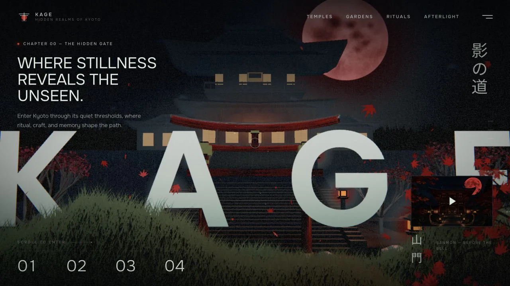

<div align="center">



# Gaurav Rajbhar — Portfolio

**A cinematic, scroll-driven WebGL portfolio — a night walk through a Kyoto mountain temple.**

Software Engineer · Full Stack · AI/ML

[](LICENSE)
[](#-deployment)
[](https://github.com/RezZup/Portfolio/commits/main)
[](https://github.com/RezZup/Portfolio/actions/workflows/quality.yml)

[**Live site →**](#-deployment) &nbsp;·&nbsp; [GitHub](https://github.com/RezZup) &nbsp;·&nbsp; [LinkedIn](https://www.linkedin.com/in/gauravrajbhar00) &nbsp;·&nbsp; [Email](mailto:Gauravrajbhar2115@gmail.com)

</div>

---

## ✨ What this is

A single-page portfolio built as a five-chapter night walk through a fictional Kyoto mountain temple (**Kage** — 影, *shadow*). The environment is a fixed full-viewport Three.js scene; scrolling drives one continuous camera path, so every section — About, Projects, Skills, Honours, Credentials, Contact — arrives as a newly composed shot rather than a page jump.

## 🎬 Features

- **Procedural 3D world** — temple, torii, stairs, lanterns, terrain, fog, rain, drifting leaves and a vermilion moon, all generated in code (no model files)
- **Scroll-driven camera** — one continuous shot powered by Lenis smooth scrolling
- **Live mini-viewports** — each project card renders its own real-time 3D viewport on hover
- **Word-by-word reveals**, parallax foreground layers, film grain, vignette and bloom
- **Accessible by default** — reduced-motion support, semantic landmarks, keyboard skip-link
- **Zero build tooling** — one HTML file, local assets, relative paths; deploys anywhere static
- **No trackers, no frameworks, no remote fonts** (fonts self-hosted via `fonts.css`)

## 🗂 Project structure

```
├── index.html                  # the entire site (markup + styles + scene code)
├── assets/
│   └── kage-preview.webp       # OpenGraph / social sharing banner
├── secret-pathways-assets/
│   ├── three.min.js            # Three.js runtime (local)
│   ├── fonts.css               # self-hosted fonts
│   ├── foreground/png/         # WebP cutout layers (sakura, pines, lanterns…)
│   ├── generated/              # cinematic stills
│   └── portrait/               # About-section portrait
├── robots.txt · sitemap.xml    # SEO
├── 404.html                    # themed not-found page (GitHub Pages)
└── PROMPT.md                   # original design specification
```

## 🚀 Run locally

Any static server works — no build step:

```bash
git clone https://github.com/RezZup/Portfolio.git
cd Portfolio
python3 -m http.server 8000
# open http://localhost:8000
```

## 🌐 Deployment

Deployed with **GitHub Pages**:

1. Repo → **Settings → Pages**
2. Source: *Deploy from a branch* → Branch: `main`, folder: `/ (root)`
3. The site goes live at `https://rezzup.github.io/Portfolio/`

## 📝 Customizing

- **Résumé button** — drop your PDF at `assets/Gaurav-Rajbhar-Resume.pdf`, then uncomment the marked block in the Contact section of `index.html`
- **Project previews** — the project cards accept preview imagery inside each `card-fr` frame
- **Social preview image** — replace `assets/kage-preview.webp` (keep the filename)

## 🙏 Credits

- Template/design: [Kage by MengTo](https://github.com/MengTo/kage)
- Smooth scrolling: [Lenis](https://github.com/darkroomengineering/lenis)
- Rendering: [Three.js](https://threejs.org/)

## 📄 License

[MIT](LICENSE) © 2026 Gaurav Rajbhar
