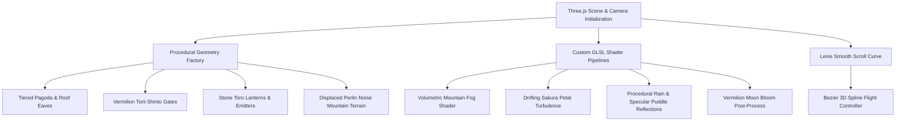

# Yokoso Procedural 3D World Synthesis Guide

Yokoso synthesizes an entire atmospheric Kyoto mountain temple environment directly in code without requiring external 3D model files (.gltf / .obj).

## 1. Zero-Asset Architectural Synthesis

- **Pagoda Tiering:** Recursive procedural scaling with curved overhang eaves computed via parabolic coordinate offsets.
- **Torii Gates:** Cylindrical pillars with tapered kasagi upper lintels rendered in vermilion lacquer tones.
- **Stone Lanterns (Tōrō):** Hexagonal base, fire box (hibukuro) with procedural warm flicker point light, and peaked umbrella roof (kasa).
- **Procedural Mountain Terrain:** PlaneGeometry vertex displacement using layered simplex octaves for realistic ridgelines.
